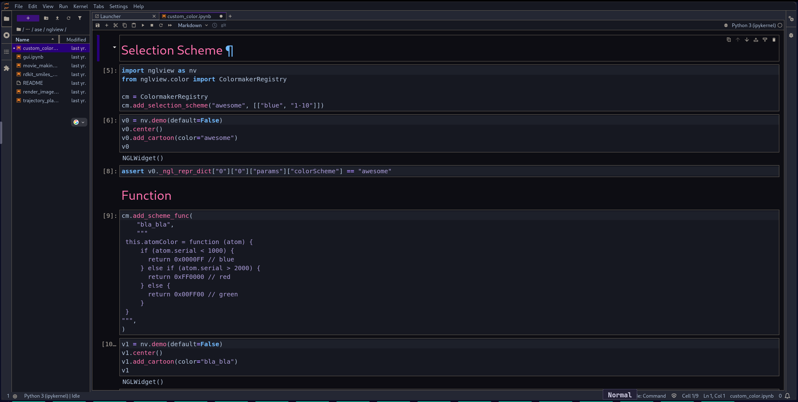
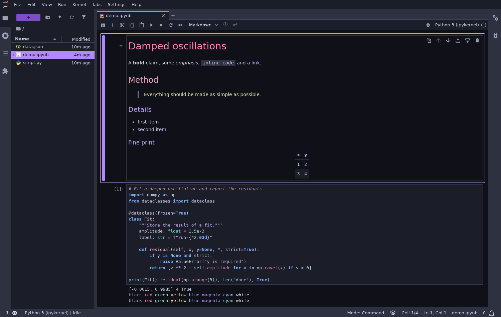
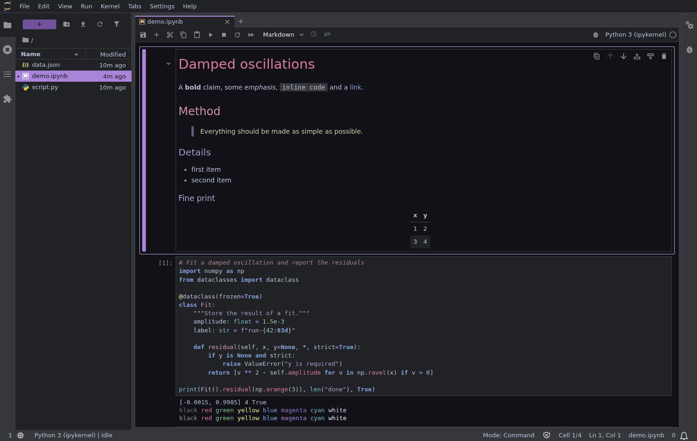
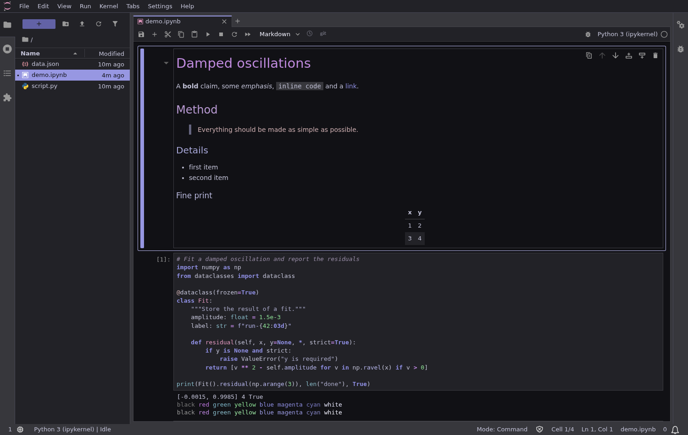
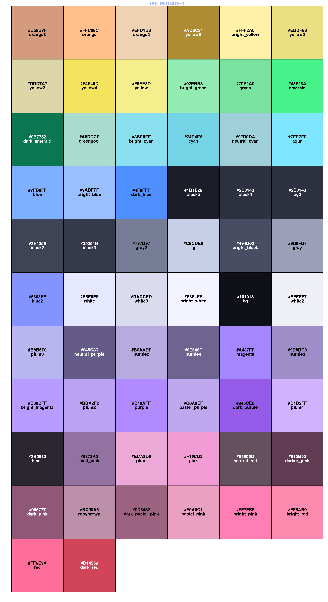
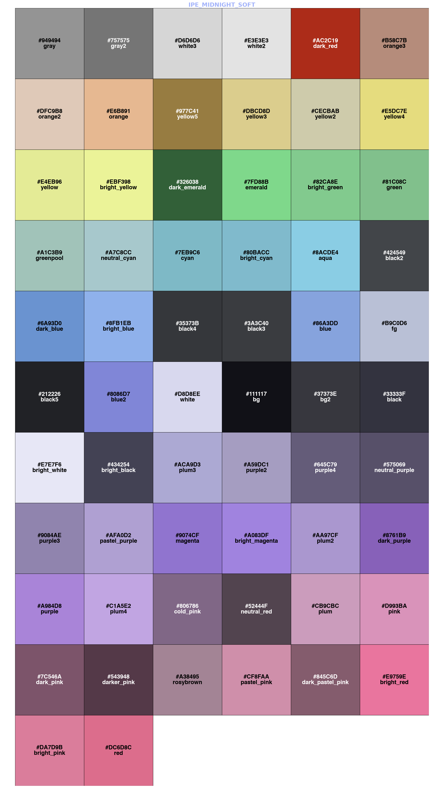
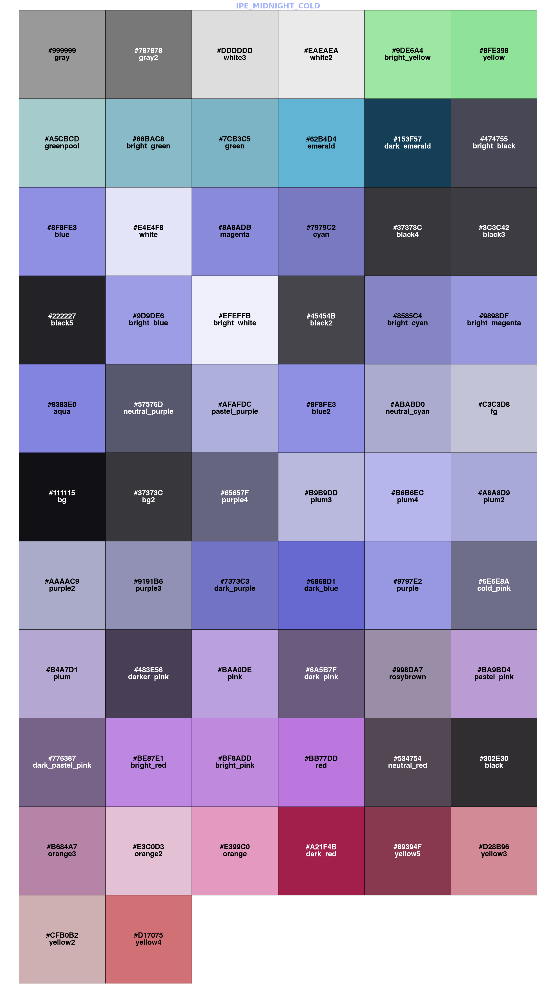

# Ipe Midnight for JupyterLab

**A comfy dark JupyterLab theme**

Includes jupyter console and ipython support

[](mailto:eduardotcampos@hotmail.com)
[](https://opensource.org/license/bsd-3-clause-open-mpi)
[](https://www.python.org/downloads/release/python-3148/)
[](https://github.com/jupyterlab/jupyterlab)

> [!WARNING]
> Dark only theme



It comes with the three variants:

| Theme               | Character                                  |
| ------------------- | ------------------------------------------ |
| `Ipe Midnight`      | The original: vivid pinks, purples, blues  |
| `Ipe Midnight Soft` | The same hues, muted for long sessions     |
| `Ipe Midnight Cold` | Cool hues only: indigo, violet, teal, mint |

<table>
  <tr>
    <td align="center">
      <strong>Default</strong><br>
      
    </td>
    <td align="center">
      <strong>Soft</strong><br>
      
    </td>
    <td align="center">
      <strong>Cold</strong><br>
      
    </td>
  </tr>
</table>

1. [Requirements](#requirements)

2. [Install](#install)

3. [IPython and Jupyter Console](#ipython-and-jupyter-console)

4. [Color Palettes](#color-palettes)

5. [Development](#development)

6. [Support](#support)

## Requirements

- JupyterLab 4

## Install

```bash
pip install jupyterlab_ipe_midnight_theme
```

Then pick a variant under **Settings > Theme**. To remove it, run
`pip uninstall jupyterlab_ipe_midnight_theme`.

## IPython and Jupyter Console

The package also installs terminal themes named `ipe-midnight`, `ipe-midnight-soft` and
`ipe-midnight-cold`. They use the JupyterLab syntax colors and are made for a dark terminal
background. Terminal programs are configured separately, so these themes do not follow the
variant selected in JupyterLab.

**IPython**, in `ipython_config.py`:

```python
c.InteractiveShell.colors = "ipe-midnight"
c.TerminalInteractiveShell.true_color = True
```

IPython 9.0 to 9.17 cannot discover installed themes, so also add this before the lines above:

```python
from jupyterlab_ipe_midnight_theme.terminal import register_ipython_themes

register_ipython_themes()
```

Changing `InteractiveShell.colors` also applies to tracebacks printed by IPython kernels, which
includes Jupyter Console and JupyterLab. Use `TerminalInteractiveShell.colors` to limit it to the
`ipython` command.

**Jupyter Console**, in `jupyter_console_config.py`:

```python
from jupyterlab_ipe_midnight_theme.terminal import console_prompt_styles

c.ZMQTerminalInteractiveShell.highlighting_style = "ipe-midnight"
c.ZMQTerminalInteractiveShell.highlighting_style_overrides = console_prompt_styles("ipe-midnight")
c.ZMQTerminalInteractiveShell.true_color = True
```

Any `highlighting_style_overrides` you already set take priority over the theme in IPython, and
replace the prompt colors in Jupyter Console, so remove them first.

The completion menu keeps the default colors, because IPython themes cannot style it.

## Color Palettes

- <details>
    <summary>Ipe Midnight</summary>

  

  </details>

- <details>
    <summary>Ipe Midnight Soft</summary>

  

  </details>

- <details>
    <summary>Ipe Midnight Cold</summary>

  

  </details>

## Development

**Any change, fix, addition or bug report are welcome and appreciated.**

You need NodeJS and Python 3.14, and JupyterLab 4 to build the extension.

```bash
pip install -e ".[dev]"             # also runs the first build
jupyter-builder develop . --overwrite
jlpm watch                          # rebuild on change, then refresh the browser
```

The colors live in three stylesheets in `style/`:

| File            | Purpose                                                  |
| --------------- | -------------------------------------------------------- |
| `palette.css`   | The raw `--ipe-*` colors of each variant.                |
| `variables.css` | Maps the palette to JupyterLab's `--jp-*` theme API.     |
| `overrides.css` | Covers what has no variable: ANSI output, headings, etc. |

The IPython and Jupyter Console colors live in the JSON files of
`jupyterlab_ipe_midnight_theme/terminal_themes/`. They hold the same colors as `palette.css`, so
change both together: the tests fail if they stop matching.

Check your code changes with:

```bash
pytest            # design rules, terminal themes and docstring examples
jlpm lint:check   # stylelint, prettier and eslint
ruff check .      # python lint
ruff format --check .
codespell         # spelling
```

## Support

Support me and check some of my other themes:

- [jupyterlab ariakedark](https://github.com/eduardotlc/jupyterlab_ariakedark_theme)

- [jupyterlab midnightsea](https://github.com/eduardotlc/jupyterlab_midnightsea_theme)

- [jupyterlab materialdarker](https://github.com/eduardotlc/jupyterlab_materialdarker_theme)

- [neovim ipe midnight](https://github.com/eduardotlc/ipe-midnight.nvim)

  - Neovim colorscheme repo includes `markdown css` styles and `kitty terminal` themes.
